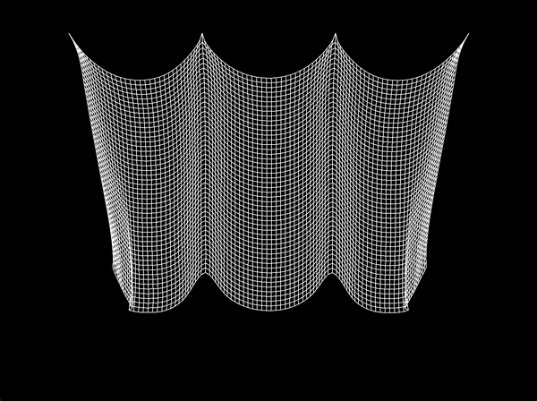
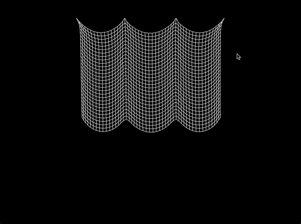
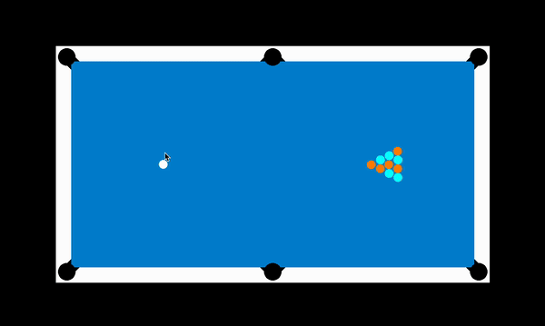
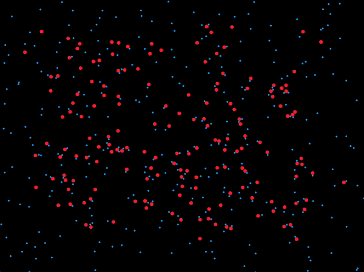

# Physics Simulator – C++, RayLib, Emscripten

**Interactive physics simulation in-browser with modular C++ library**

## Overview

This project is a **modular physics simulation library** implemented in **C++** using **RayLib**. It supports **hundreds of interacting particles**, with collisions, constraints, and force models. The simulation is compiled to **WebAssembly via Emscripten**, allowing users to run and interact with it directly in the browser.

## Key Features

- **Particle Simulation:** Supports hundreds of particles with real-time collisions and interactions  
- **Constraints:** Connect particles using distance, spring, or custom constraints  
- **Integration Methods:** Euler and vector-based integration systems for particle motion  
- **Forces:** Apply both external forces and inter-particle forces  
- **Obstacles:** Include custom-shaped obstacles that interact with particles  
- **User Interactivity:** Manipulate the simulation in real-time using the mouse, including injecting forces and editing constraints  
- **Web Deployment:** Compiled to **WebAssembly** with Emscripten for in-browser execution  

## Tech Stack

- **Programming Language:** C++  
- **Graphics & Interaction:** RayLib  
- **Web Deployment:** Emscripten (WebAssembly)  
- **Physics Engine:** Custom modular particle system  

## Demo

Live demo: [View Live Demo](https://lkxben.github.io/PhysicsSimulator/)

### Cloth Cutting


### Cloth Movement


### Pool


### Plasma Cloud


### Three Body


## How to Run Locally

```bash
# Clone the repo
git clone https://github.com/yourusername/PhysicsSimulator.git
cd PhysicsSimulator

# Build and run locally using RayLib
mkdir build && cd build
cmake ..
make

# Binaries are found in bin
cd bin
